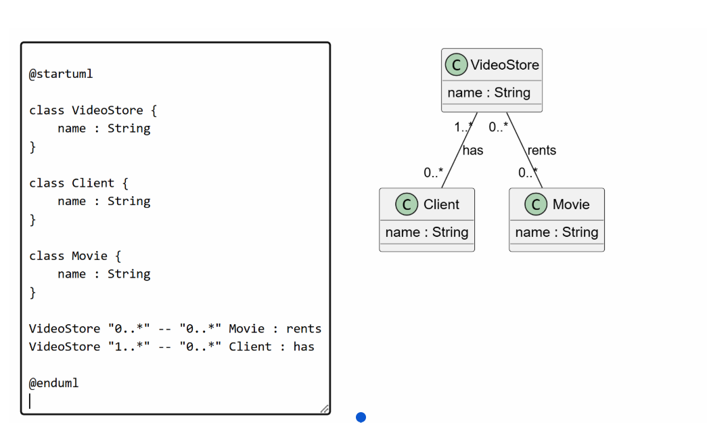
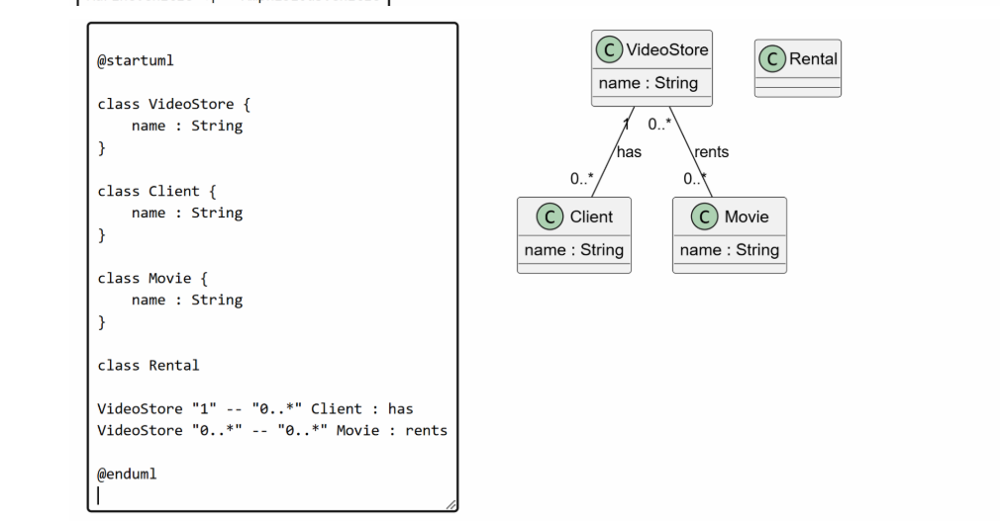
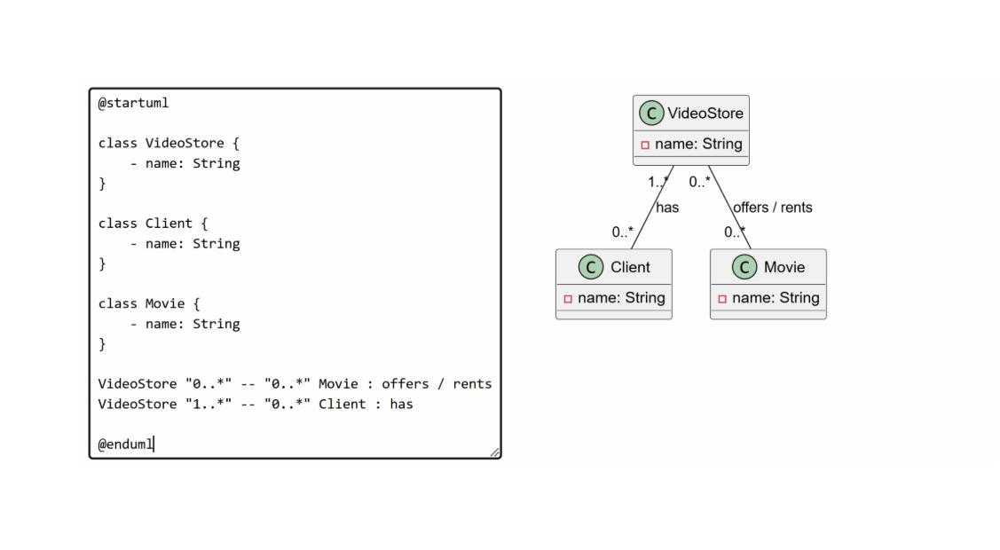
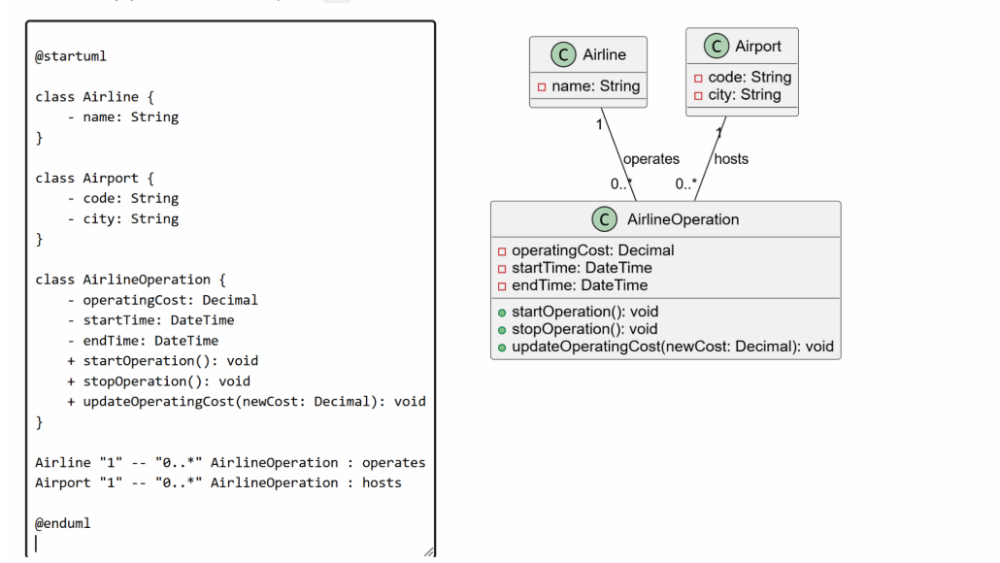
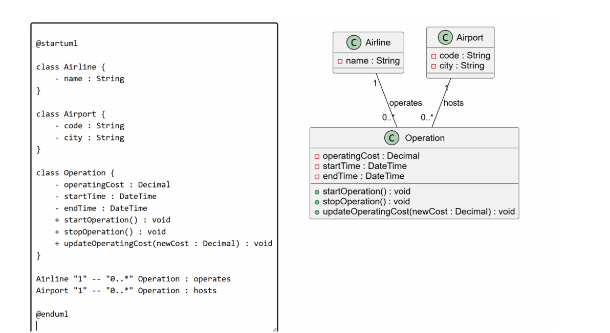
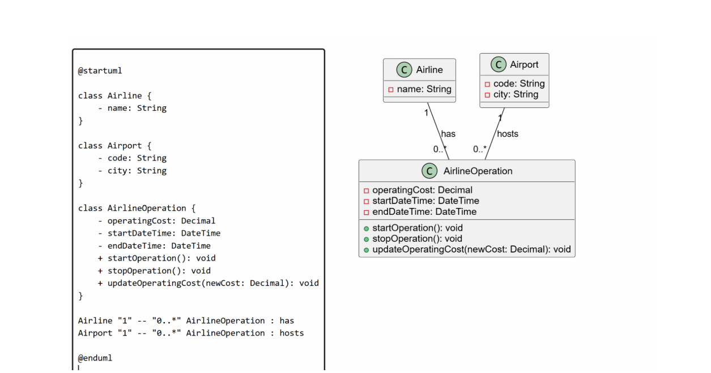
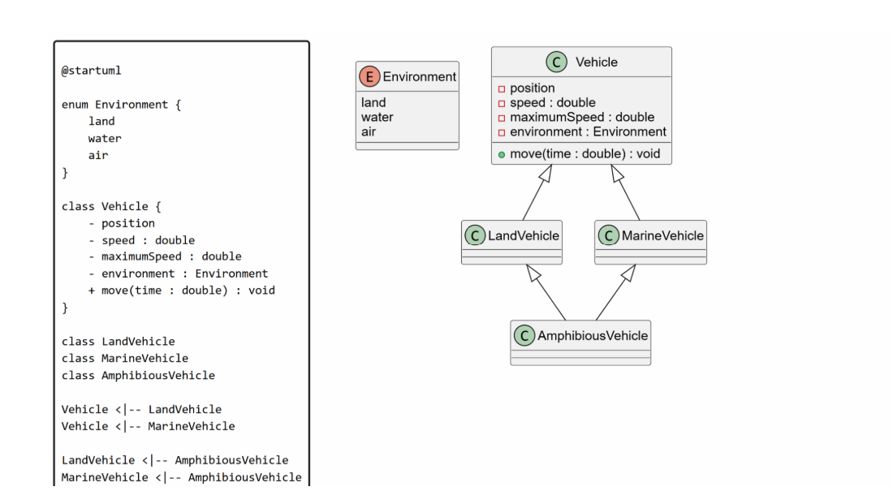
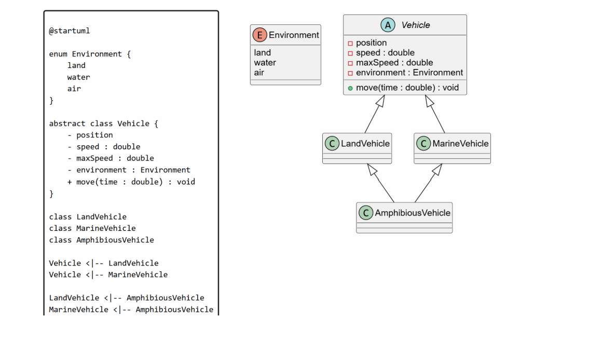
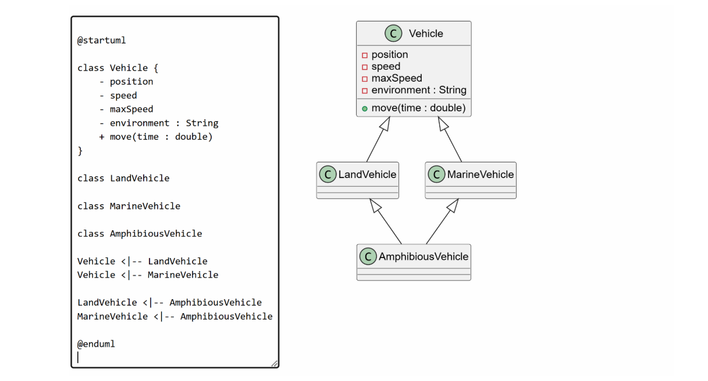

# Screenshots – eksperimenti 2026

Për secilin output: majtas kodi PlantUML që dha ChatGPT (Temporary Chat, 21.11.2026, një prompt pa korrigjime),
djathtas diagrami i renderuar në PlantText. Poshtë çdo ushtrimi është dalja e `score_uml.py` kundrejt modelit synim
(`targets/`). Kodi i plotë është te `outputs/`, rezultatet në CSV te `results/`.

## Video club

Modeli synim: `VideoStore "*" -- "*" Client` dhe `VideoStore "*" o-- "*" Movie`.

| Run | Screenshot | F1 | Shumëfishësi të sakta | Vërejtje |
|---|---|---|---|---|
| 1 | [video_run1.png](video_run1.png) | 1,00 | 1/2 | VideoStore–Client: `1..*` – `0..*` në vend të `*` – `*` |
| 2 | [video_run2.png](video_run2.png) | 0,94 | 1/2 | klasë e tepërt `Rental` pa asnjë lidhje; VideoStore–Client: `1` – `0..*` |
| 3 | [video_run3.png](video_run3.png) | 1,00 | 1/2 | VideoStore–Client: `1..*` – `0..*`; emri i asociacionit „offers / rents” |





```
python score_uml.py targets/video.puml outputs/video_run1.puml outputs/video_run2.puml outputs/video_run3.puml --csv results/2026_video.csv

=== outputs/video_run1.puml
kategoria          TP  FP  FN      P      R     F1
classes             3   0   0   1.00   1.00   1.00
attributes          3   0   0   1.00   1.00   1.00
associations        2   0   0   1.00   1.00   1.00
TOTAL               8   0   0   1.00   1.00   1.00
shumëfishësi të sakta: 1/2
PËRPUTHJE E PLOTË me modelin synim: JO

=== outputs/video_run2.puml
kategoria          TP  FP  FN      P      R     F1
classes             3   1   0   0.75   1.00   0.86
attributes          3   0   0   1.00   1.00   1.00
associations        2   0   0   1.00   1.00   1.00
TOTAL               8   1   0   0.89   1.00   0.94
shumëfishësi të sakta: 1/2
PËRPUTHJE E PLOTË me modelin synim: JO

=== outputs/video_run3.puml
kategoria          TP  FP  FN      P      R     F1
classes             3   0   0   1.00   1.00   1.00
attributes          3   0   0   1.00   1.00   1.00
associations        2   0   0   1.00   1.00   1.00
TOTAL               8   0   0   1.00   1.00   1.00
shumëfishësi të sakta: 1/2
PËRPUTHJE E PLOTË me modelin synim: JO
```

## Airlines

Modeli synim: `Airline "*" -- "*" Airport : operates` me association class `Details`
(`operatingCost`, `start()`, `stop()`, `updateCost(newCost)`).

| Run | Screenshot | F1 | Vërejtje |
|---|---|---|---|
| 1 | [airline_run1.png](airline_run1.png) | 0,38 | klasë e ndërmjetme `AirlineOperation` me dy asociacione `1` – `0..*`; shton `startTime`, `endTime` |
| 2 | [airline_run2.png](airline_run2.png) | 0,38 | e njëjta strukturë, klasa quhet `Operation` |
| 3 | [airline_run3.png](airline_run3.png) | 0,38 | `AirlineOperation`, atributet `startDateTime`, `endDateTime`; asociacioni „has” në vend të „operates” |

Në asnjë run nuk ka association class dhe as asociacion të drejtpërdrejtë Airline–Airport. Operacionet
(`startOperation`, `stopOperation`, `updateOperatingCost`) kanë kuptimin e duhur, por emrat ndryshojnë nga modeli
synim, prandaj numërohen si FP/FN.





```
python score_uml.py targets/airlines.puml outputs/airlines_run1.puml outputs/airlines_run2.puml outputs/airlines_run3.puml --csv results/2026_airlines.csv

=== outputs/airlines_run1.puml   (run2 dhe run3 japin të njëjtat vlera)
kategoria          TP  FP  FN      P      R     F1
classes             2   1   1   0.67   0.67   0.67
attributes          3   3   1   0.50   0.75   0.60
operations          0   3   3   0.00   0.00   0.00
associations        0   2   1   0.00   0.00   0.00
assoc_classes       0   0   1   0.00   0.00   0.00
TOTAL               5   9   7   0.36   0.42   0.38
shumëfishësi të sakta: 0/0
PËRPUTHJE E PLOTË me modelin synim: JO
```

## Amphibious

Modeli synim: `abstract class Vehicle` (position, speed, maxSpeed, environment : Environment, move(time)),
`enum Environment {land, water, air}`, `LandVehicle` dhe `MarineVehicle` trashëgojnë nga `Vehicle`,
`AmphibiousVehicle` trashëgon nga të dyja.

| Run | Screenshot | F1 | Përputhje e plotë | Vërejtje |
|---|---|---|---|---|
| 1 | [amphibious_run1.png](amphibious_run1.png) | 0,97 | JO | `Vehicle` jo abstract; `maximumSpeed` në vend të `maxSpeed` (pranohet me `--alias`) |
| 2 | [amphibious_run2.png](amphibious_run2.png) | 1,00 | PO | përputhet plotësisht |
| 3 | [amphibious_run3.png](amphibious_run3.png) | 0,84 | JO | `Vehicle` jo abstract; pa enum, `environment : String` |

Të 3 run-et i kanë 4 trashëgimitë të sakta.





```
python score_uml.py targets/amphibious.puml outputs/amphibious_run1.puml outputs/amphibious_run2.puml outputs/amphibious_run3.puml --csv results/2026_amphibious.csv --alias maximumSpeed=maxSpeed

=== outputs/amphibious_run1.puml
kategoria          TP  FP  FN      P      R     F1
classes             4   0   0   1.00   1.00   1.00
abstract_classes    0   0   1   0.00   0.00   0.00
enums               1   0   0   1.00   1.00   1.00
attributes          7   0   0   1.00   1.00   1.00
operations          1   0   0   1.00   1.00   1.00
generalizations     4   0   0   1.00   1.00   1.00
TOTAL              17   0   1   1.00   0.94   0.97
shumëfishësi të sakta: 0/0
PËRPUTHJE E PLOTË me modelin synim: JO

=== outputs/amphibious_run2.puml
kategoria          TP  FP  FN      P      R     F1
classes             4   0   0   1.00   1.00   1.00
abstract_classes    1   0   0   1.00   1.00   1.00
enums               1   0   0   1.00   1.00   1.00
attributes          7   0   0   1.00   1.00   1.00
operations          1   0   0   1.00   1.00   1.00
generalizations     4   0   0   1.00   1.00   1.00
TOTAL              18   0   0   1.00   1.00   1.00
shumëfishësi të sakta: 0/0
PËRPUTHJE E PLOTË me modelin synim: PO

=== outputs/amphibious_run3.puml
kategoria          TP  FP  FN      P      R     F1
classes             4   0   0   1.00   1.00   1.00
abstract_classes    0   0   1   0.00   0.00   0.00
enums               0   0   1   0.00   0.00   0.00
attributes          4   0   3   1.00   0.57   0.73
operations          1   0   0   1.00   1.00   1.00
generalizations     4   0   0   1.00   1.00   1.00
TOTAL              13   0   5   1.00   0.72   0.84
shumëfishësi të sakta: 0/0
PËRPUTHJE E PLOTË me modelin synim: JO
```

## Përmbledhje

| Ushtrimi | F1 run1 | F1 run2 | F1 run3 | F1 mes. | Përputhje e plotë |
|---|---|---|---|---|---|
| Video club | 1,00 | 0,94 | 1,00 | 0,98 | 0/3 |
| Airlines | 0,38 | 0,38 | 0,38 | 0,38 | 0/3 |
| Amphibious | 0,97 | 1,00 | 0,84 | 0,94 | 1/3 |
